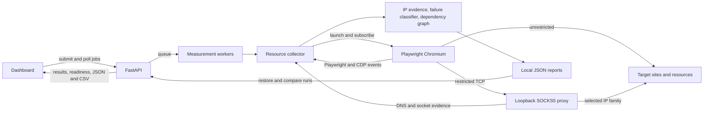
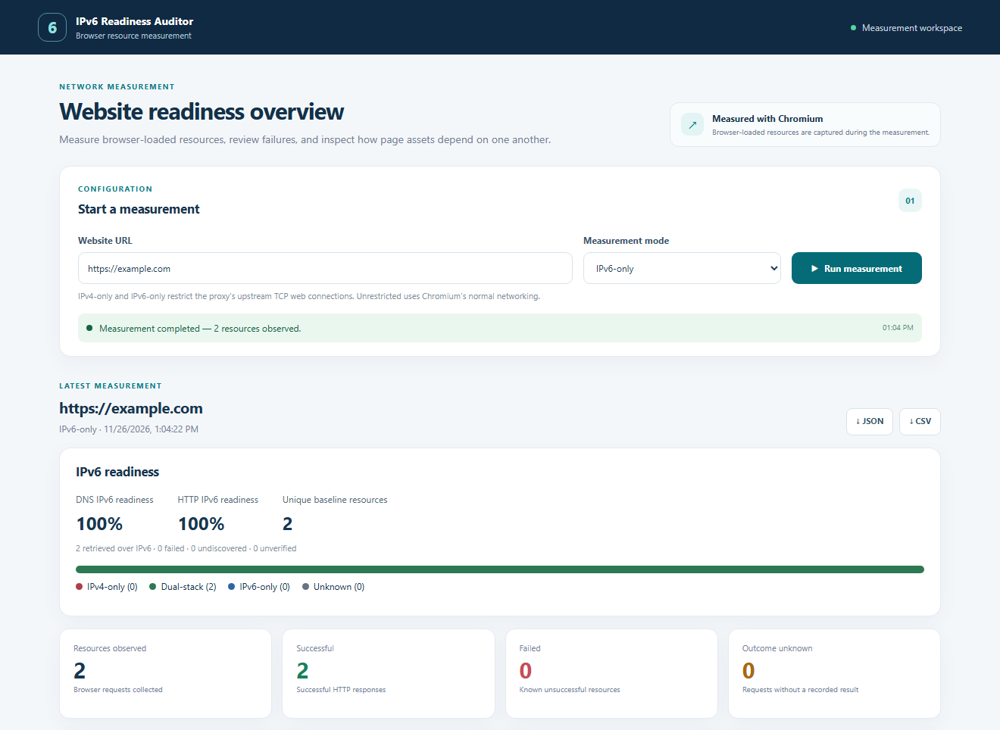

# IPv6 Readiness Auditor

IPv6 Readiness Auditor measures whether a public website and the web resources it loads are reachable over IPv6. A page can have an IPv6 address while its scripts, stylesheets, images, or API endpoints still depend on IPv4. The auditor captures the requests Chromium makes during a page visit and compares normal browser behavior with IP-family-restricted runs.

Use it to review a deployment before enabling IPv6, identify third-party dependencies that need attention, or collect comparable evidence for network operations and research.

## Key features

- **Browser-based discovery** captures navigation and subresource requests, timings, HTTP statuses, and browser errors.
- **Three measurement modes** provide unrestricted, IPv4-only, and IPv6-only runs. Restricted modes use a per-measurement SOCKS5 TCP proxy.
- **Address evidence** distinguishes resolved IPv4 and IPv6 addresses, browser-observed peers, and proxy connection attempts.
- **Multi-layer dependency graphs** use Chromium initiator evidence and color nodes by DNS capability.
- **IPv6 readiness metrics** separate DNS capability from demonstrated HTTP(S) retrieval over IPv6.
- **Failure classification** distinguishes DNS, unavailable IP families, TCP, TLS, HTTP errors, timeouts, browser blocking or cancellation, and unknown causes.
- **Interactive dashboard and local reports** provide filtering, resource details, JSON and CSV downloads, and saved measurements that can be reopened by API job ID.

## Installation

The documented environment is **Windows with PowerShell and Python 3.12**. Project verification uses Playwright's Chromium on Windows. Other operating systems have no documented project verification. Install Git and ensure Python 3.12 is on PATH. Initial setup needs access to the Python package index and Playwright browser downloads. Measurements need DNS and connectivity from the host to the target. IPv6-only retrieval requires a working upstream IPv6 path.

Clone using the Git URL from the repository's **Code** menu or your fork. Run the remaining commands from the checkout root.

```powershell
$repositoryUrl = https://github.com/PrabalSingh298/IPv6-Readiness-Auditor.git
git clone $repositoryUrl IPv6-Readiness-Auditor
Set-Location IPv6-Readiness-Auditor
python --version
python -m venv .venv
.\.venv\Scripts\python.exe -m pip install -r requirements.txt
.\.venv\Scripts\python.exe -m playwright install chromium
.\.venv\Scripts\python.exe -m uvicorn backend.main:app --host 127.0.0.1 --port 8000
```

These commands use the virtual environment's interpreter directly. Open the [local dashboard](http://127.0.0.1:8000/).

## Quick start

1. Enter a public HTTP(S) URL, including the scheme. Start with `https://example.com/`.
2. Select **Unrestricted** and run the measurement. This establishes the baseline of unique HTTP(S) resource URLs.
3. Run **IPv6-only** for the same URL. The report compares that run with the saved unrestricted baseline. Use **IPv4-only** when you need a separate IPv4 control.
4. Compare DNS and HTTP readiness. Use the failure breakdown, resource filters, and graph node details to investigate individual results.
5. Download **JSON** for the full evidence or **CSV** for a resource-oriented export. Keep the report IDs and environment details when comparing runs.

The collector can also run without the dashboard. It writes a single JSON report and prints its output path. Cross-run readiness pairing is available through the dashboard and API.

```powershell
.\.venv\Scripts\python.exe -m backend.measurement.resource_collector "https://example.com/" 30000 ipv6_only
```

## System architecture

FastAPI serves the dashboard and accepts jobs. A two-worker thread pool runs the collector. Each job launches a fresh Chromium session and, for restricted measurements, a loopback proxy. The collector combines browser events with address evidence, classifies results, builds the dependency graph, and saves the report. Report and export requests calculate readiness using eligible saved measurements.



| Layer | Technology |
| --- | --- |
| Backend and runtime | Python, FastAPI, Pydantic request models, Uvicorn |
| Browser automation | Playwright for Python, Chromium, Chrome DevTools Protocol (CDP) |
| IP-family isolation | Python `asyncio` and sockets, SOCKS5 CONNECT, TCP, system address resolution |
| Dashboard | HTML, CSS, vanilla JavaScript, SVG dependency graph |
| Reports and tests | Local JSON, CSV, Python `unittest`, local HTTP and HTTPS fixtures |

## Measurement modes

| Dashboard mode | CLI and API value | Behavior |
| --- | --- | --- |
| Unrestricted | `unrestricted` | Chromium uses its normal networking and can select either address family. |
| IPv4-only | `ipv4_only` | The proxy opens upstream IPv4 TCP sockets. A destination with no IPv4 candidate fails inside the proxy. |
| IPv6-only | `ipv6_only` | The proxy opens upstream IPv6-only TCP sockets and excludes IPv4-mapped IPv6 addresses. A destination with no eligible IPv6 candidate fails inside the proxy. |

Restricted runs bind a temporary SOCKS5 listener to `127.0.0.1`. The browser-to-proxy connection stays local. The selected family applies to the proxy's upstream connections. The proxy retries candidates only within that family. Chromium verifies HTTPS certificates normally over the tunnel. Browser launch settings disable QUIC, remove Chromium's implicit loopback proxy bypass, and restrict non-proxied WebRTC UDP.

## Measurement methodology

### Browser discovery and dependency evidence

The collector opens a fresh Chromium page, navigates until `domcontentloaded`, and allows an additional one-second observation window. It records the requests, responses, and failures Chromium emits. The dashboard groups resources by request URL. It does not crawl linked pages or perform scripted user interactions.

The graph links a parent to a child when Chromium's reported initiator URL matches a captured resource. Direct relationships are individual edges. Indirect relationships follow a chain of edges, such as document → stylesheet → background image. Nodes with no evidence linking them to a captured root lack a depth. The dashboard displays verified layers and identifies resources whose dependencies remain unknown.

### IP evidence and resource classification

Address enrichment uses at most one system lookup per hostname per measurement and reuses the restricted proxy's lookup when available. IP-literal URLs use their address directly. A resource's address lists describe its observed host capability. In unrestricted mode, CDP can identify a remote peer for a network response. In restricted modes, socket evidence identifies attempted and connected peers at hostname-and-port scope. Several resources can share a proxy connection, so restricted reports leave the individual resource peer blank.

| Color | DNS capability | Evidence |
| --- | --- | --- |
| Red | IPv4-only | IPv4 addresses observed and no IPv6 addresses in the lookup result |
| Green | Dual-stack | IPv4 and IPv6 addresses observed |
| Blue | IPv6-only | IPv6 addresses observed and no IPv4 addresses in the lookup result |
| Grey | Unknown | Resolution failed, returned no usable addresses, or evidence was unavailable |

Graph colors describe address availability. HTTP outcomes and failure categories appear separately.

### Readiness calculations

The denominator is the number of **unique HTTP(S) resource URLs** in the unrestricted report. Non-HTTP(S) resources such as `data:` and `blob:` are excluded. URL matching drops fragments, normalizes default ports and empty paths, and preserves paths and query strings. Unknown resources stay in the denominator and are counted separately.

| Metric | Calculation |
| --- | --- |
| DNS IPv6 readiness | `100 × (dual-stack resources + IPv6-only resources) / baseline resources` |
| HTTP IPv6 readiness | `100 × baseline resources retrieved over IPv6 / baseline resources` |

An IPv6 retrieval requires a successful network response in the IPv6-only run and IPv6-only upstream peer evidence for its hostname and port. The collector treats HTTP 200–399 as successful and excludes cache-only evidence and HTTP 304 from the readiness numerator. The comparison reports **retrieved**, **failed**, **undiscovered**, and **unverified** separately. A missing resource downstream of a failed baseline dependency can be identified as an association when the graph supports it.

The dashboard and API compare runs for the same target URL and select the latest eligible saved counterpart. The report carries both measurement IDs. HTTP readiness stays blank until a comparable IPv6-only run has attempted navigation. An empty baseline has no percentage. A DNS record alone cannot establish HTTP reachability.

### Failure classification

The auditor uses the HTTP status, Playwright error, matching CDP failure metadata, and proxy hostname-and-port evidence when available. Ambiguous causes remain unknown. A proxy observation can distinguish an unavailable requested family from a DNS error. TCP errors are attributed using conservative correlation rules. A measurement job can complete and produce a report even when its navigation or individual resources fail.

## Dashboard and visualization

The dashboard shows readiness percentages and a color-coded resource distribution, measurement totals, observed connection evidence, and a failure breakdown. **Observed Resources** supports URL and hostname search, result and type filters, and expandable failure and IP details. When more than 10 rows match, the list has an independent scrollbar and sticky header. All matching rows remain accessible. Select verified graph nodes for resource details.



The screenshot shows an example measurement of `example.com` captured from the running dashboard. Results vary by run and network.

## Project structure

```text
.
├── backend/
│   ├── api/
│   └── measurement/
├── frontend/
├── controlled_site/
│   └── dependency_test/
├── examples/
├── tests/
├── experiments/
├── docs/images/          Dashboard screenshot
├── data/                 Created at runtime
└── requirements.txt
```

| Directory | Responsibility |
| --- | --- |
| [backend](backend/README.md) | FastAPI entry point, job execution, measurement orchestration |
| [backend/api](backend/api/README.md) | API contracts, job state, saved reports, and exports |
| [backend/measurement](backend/measurement/README.md) | Collector, SOCKS5 isolation, evidence, graph, and scoring |
| [frontend](frontend/README.md) | Dashboard and visualizations |
| [controlled_site](controlled_site/README.md) | Local fixtures with [known dependencies](controlled_site/dependency_test/README.md) |
| [examples](examples/README.md) | Standalone Playwright and proxy usage |
| [tests](tests/README.md) | Unit, browser, and dashboard regressions |
| [experiments](experiments/README.md) | Archived material outside the supported application |

## API

The default server exposes [Swagger UI](http://127.0.0.1:8000/docs), [ReDoc](http://127.0.0.1:8000/redoc), and [OpenAPI JSON](http://127.0.0.1:8000/openapi.json). See the [API reference](backend/api/README.md) for response fields and error semantics.

| Method and path | Inputs | Result |
| --- | --- | --- |
| `GET /` | None | Dashboard HTML |
| `GET /api/capabilities` | None | Measurement modes |
| `POST /api/measurements` | JSON `url` and optional `mode` | HTTP 202 with job ID and status URL |
| `GET /api/measurements/{job_id}` | Job ID | Status and available summary |
| `GET /api/measurements/{job_id}/report` | Job ID | Report with computed readiness |
| `GET /api/measurements/{job_id}/resources/{resource_index}` | Job ID and zero-based resource index | One resource record |
| `GET /api/measurements/{job_id}/export.json` | Job ID | Full report download |
| `GET /api/measurements/{job_id}/export.csv` | Job ID | Resource and readiness columns |

```powershell
$base = 'http://127.0.0.1:8000'
$body = @{ url = 'https://example.com/'; mode = 'unrestricted' } | ConvertTo-Json
$job = Invoke-RestMethod -Method Post -Uri "$base/api/measurements" -ContentType 'application/json' -Body $body
Invoke-RestMethod -Uri "$base$($job.status_url)"
```

Once the status is `completed`, download the report.

```powershell
Invoke-WebRequest -Uri "$base/api/measurements/$($job.id)/export.json" -OutFile measurement.json
```

## Testing

Run the suite from the checkout root after installing Chromium. The controlled tests use local IPv4 and IPv6 listeners and fixed DNS answers where needed. Set `OPENSSL` to a local OpenSSL executable if it is missing from PATH and you want to run the HTTPS fixture test.

```powershell
.\.venv\Scripts\python.exe -m unittest discover -s tests -p "test_*.py" -v
.\.venv\Scripts\python.exe tests/test_browser_launch.py
```

The [testing guide](tests/README.md) lists focused commands and the optional live-site smoke check.

## Security and privacy

- Run the dashboard on loopback. The API has no built-in authentication, and the temporary SOCKS5 listener is unauthenticated and reachable by local processes. The supported workflow needs no administrator privileges or system-wide configuration changes.
- The collector accepts HTTP(S) targets and rejects embedded credentials, localhost names, and private, loopback, or link-local IP literals. These checks apply to the submitted URL. DNS answers, redirects, and subresources are outside those checks. Keep the service local and use targets you are authorized to measure.
- Completed reports are written to `data/phase3_*.json` and restored at dashboard startup. Queue state exists in memory while the server runs. JSON can contain URLs with query strings, captured headers, request bodies, and peer addresses. Review reports before sharing. Generated report files under `data/` are ignored by Git.

## Known limitations

- Isolation applies to proxied Chromium TCP web traffic. System DNS may use either address family. Other applications, UDP, and WebRTC paths beyond Chromium's launch settings are outside the measurement scope.
- VPNs, system routing, and DNS64/NAT64 can change the path. An IPv6 proxy socket can still reach an IPv4 origin through translation.
- System resolver results can vary by network, CDN, and time. A successful lookup can omit an address family without exposing the underlying per-record error. Chromium can resolve independently in unrestricted mode.
- Cache, service workers, connection reuse, redirects, and dynamic content affect what the browser observes. Initiator and response peer evidence can be incomplete. Restricted proxy evidence cannot establish an exact resource-to-socket mapping.
- Readiness reflects the URLs and timing of the selected runs. It does not extrapolate to unvisited pages, other networks, or user interactions.

## Troubleshooting

| Symptom | What to check |
| --- | --- |
| Python or imports are missing | Confirm `python --version` reports 3.12 before creating the environment. Install using the same `.venv` interpreter that starts the dashboard. |
| Chromium executable is missing | Run `.\.venv\Scripts\python.exe -m playwright install chromium`, then run the browser launch check. |
| Dashboard does not open | Start Uvicorn from the repository root. If port 8000 is occupied, pass another loopback port and open that URL. Read startup errors in the terminal. |
| API rejects the URL | Include `http://` or `https://` and use an eligible public target. |
| IPv6-only run has no upstream peers | Check IPv6 connectivity from the measurement host and inspect the proxy outcomes. DNS address availability and successful IPv6 connectivity are separate observations. |
| HTTP readiness is blank | Run both Unrestricted and IPv6-only for the same URL. Check that the baseline contains HTTP(S) resources and that the IPv6-only run attempted navigation. |
| A comparison after restart looks different | Check the baseline and IPv6 measurement IDs. The API selects the latest eligible saved counterpart when reading or exporting a report. |

## Contributions and license

For bugs, include reproduction steps, the measurement mode, and a redacted report or relevant error. For changes, add a focused regression where appropriate and update the documentation when behavior or the report format changes. Run the relevant tests from the project root.

**Licensing is undecided.** The repository currently contains no project license file.

## References

- [Playwright Python installation](https://playwright.dev/python/docs/intro)
- [Chrome DevTools Protocol Network domain](https://chromedevtools.github.io/devtools-protocol/tot/Network/)
- [Chromium proxy support](https://chromium.googlesource.com/chromium/src/+/refs/tags/135.0.7000.0/net/docs/proxy.md)
- [Python socket address resolution](https://docs.python.org/3.12/library/socket.html#socket.getaddrinfo)
- [FastAPI and its interactive API documentation](https://fastapi.tiangolo.com/tutorial/first-steps/)
- [RFC 1928 SOCKS5](https://www.rfc-editor.org/info/rfc1928/)
- [RFC 8200 IPv6 specification](https://www.rfc-editor.org/info/rfc8200/)

